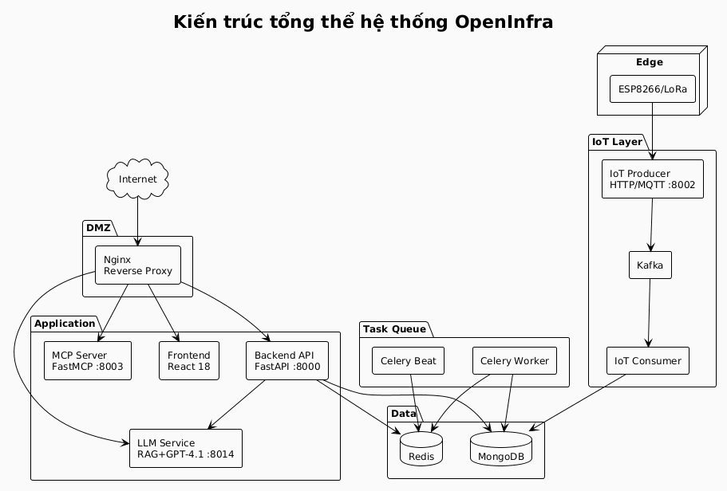
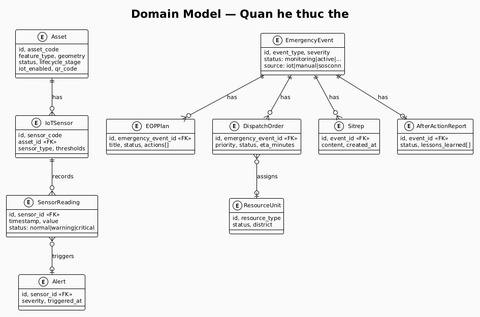
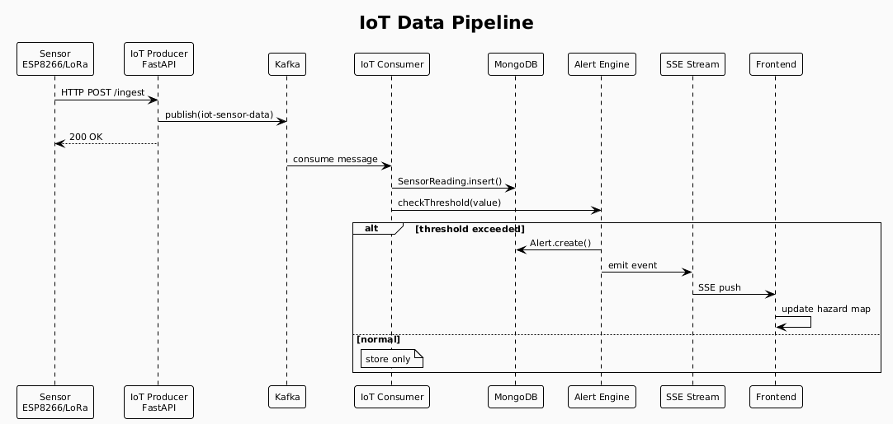
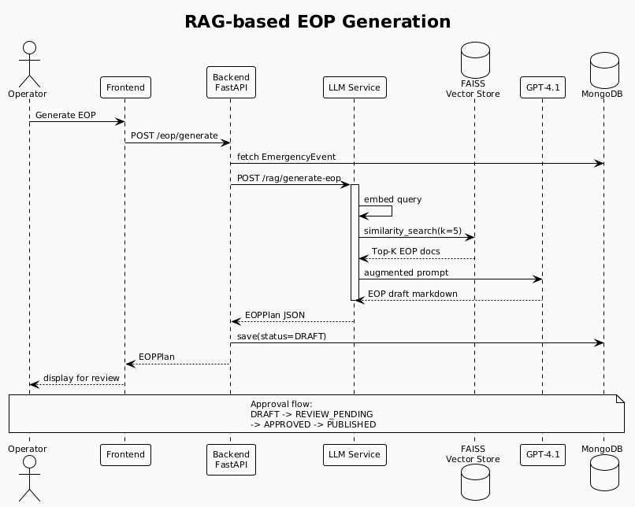
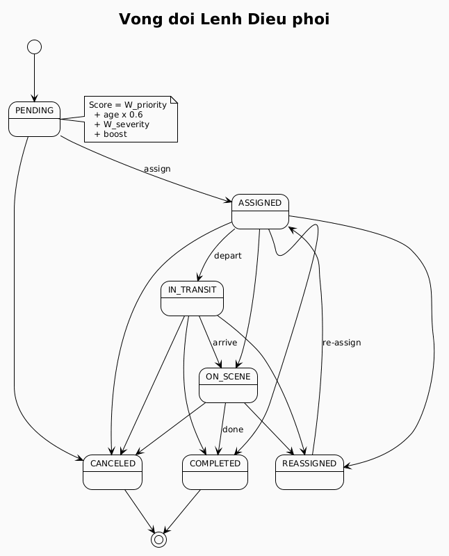

# CHƯƠNG 3: ĐỀ XUẤT GIẢI PHÁP OPENINFRA CHO HỆ THỐNG HẠ TẦNG SỐ ĐÀ NẴNG

---

## 3.1. Tổng quan giải pháp đề xuất

### 3.1.1. Bối cảnh và động lực nghiên cứu

Đô thị hóa nhanh chóng đặt ra áp lực ngày càng lớn lên hệ thống hạ tầng đô thị, đặc biệt tại các thành phố đang phát triển như Đà Nẵng — một trong những trung tâm kinh tế, du lịch và công nghệ thông tin hàng đầu của Việt Nam. Theo dữ liệu thống kê của thành phố, Đà Nẵng hiện quản lý hơn 1.200 km đường bộ, hàng nghìn công trình cơ sở hạ tầng kỹ thuật (cầu, cống, trạm điện, hệ thống thoát nước), cùng bờ biển dài dễ tổn thương trước biến đổi khí hậu và thiên tai. Các hệ thống quản lý hạ tầng truyền thống — dựa trên hồ sơ giấy tờ, bảng tính và quy trình thủ công — không còn đáp ứng được yêu cầu về tốc độ phản ứng, tính minh bạch và hiệu quả điều phối nguồn lực trong bối cảnh đô thị hiện đại [10.3390/su13137374].

Nghiên cứu này đề xuất hệ thống **OpenInfra** — một nền tảng hạ tầng số tích hợp, hợp nhất hai năng lực cốt lõi: (i) *số hóa và quản lý vòng đời tài sản hạ tầng* và (ii) *chỉ huy và điều phối khẩn cấp tích hợp AI* thông qua phân hệ SOSConn. Giải pháp được thiết kế theo nguyên tắc dữ liệu mở, khả năng tương tác ngữ nghĩa (semantic interoperability) và tự động hóa quy trình — phù hợp với lộ trình chuyển đổi số quốc gia theo Quyết định 749/QĐ-TTg của Chính phủ Việt Nam.

### 3.1.2. Định vị hệ thống và sự hợp nhất OpenInfra–SOSConn

Hệ thống OpenInfra được định vị là **nền tảng hạ tầng số đô thị thống nhất**, vận hành theo mô hình ba trục chức năng:

1. **Quản lý tài sản (Asset Management):** Số hóa toàn bộ vòng đời tài sản hạ tầng công cộng trên nền GIS, từ lập kế hoạch, thi công, vận hành đến thanh lý.
2. **Giám sát và cảnh báo sớm (Monitoring & Early Warning):** Mạng lưới IoT giám sát thời gian thực các thông số môi trường và sức khỏe công trình, tích hợp dữ liệu mở từ các nguồn bên ngoài (VNDMS, OpenWeatherMap).
3. **Chỉ huy và điều phối khẩn cấp (Command & Dispatch):** Phân hệ SOSConn tự động hóa việc tạo kế hoạch ứng phó khẩn cấp (Emergency Operation Plan - EOP) và tối ưu hóa điều phối nguồn lực cứu hộ bằng AI.

Mô hình hoạt động tuân theo chu trình **Phòng ngừa → Ứng phó → Phục hồi** (*Prevention → Response → Recovery*), phù hợp với khung Sendai Framework for Disaster Risk Reduction 2015–2030 [ISO 22320:2018].

---

## 3.2. Các đóng góp chính và Mục tiêu hệ thống

### 3.2.1. Đóng góp khoa học và kỹ thuật

Nghiên cứu này mang lại bốn đóng góp chính được xác định rõ ràng:

**Đóng góp 1: Số hóa hạ tầng đô thị trên nền GIS tích hợp ngữ nghĩa (Semantic GIS)**

Hệ thống triển khai mô hình dữ liệu không gian theo chuẩn GeoJSON-LD kết hợp với ngữ nghĩa NGSI-LD (ETSI CIM 009 v1.7.1) [ETSI GS CIM 009 V1.7.1], cho phép mỗi tài sản hạ tầng được biểu diễn như một thực thể ngữ nghĩa có thể truy vấn liên kết, thay vì chỉ là bản ghi cơ sở dữ liệu đơn thuần. Cách tiếp cận này tạo nền tảng cho khả năng tương tác dữ liệu liên hệ thống (cross-system data interoperability) [10.3390/s22155725].

**Đóng góp 2: Tự động hóa kế hoạch khẩn cấp bằng AI Agent (RAG-based EOP Generation)**

Ứng dụng kiến trúc Retrieval-Augmented Generation (RAG) [10.48550/arXiv.2005.11401] kết hợp với mô hình ngôn ngữ lớn (LLM) để tự động tạo dự thảo kế hoạch ứng phó khẩn cấp (EOP Draft) từ dữ liệu sự kiện thực tế [10.1016/j.ijdrr.2024.104523]. Đây là một trong những ứng dụng tiên phong của RAG trong lĩnh vực quản lý khủng hoảng đô thị tại Việt Nam.

**Đóng góp 3: Điều phối nguồn lực tối ưu bằng hàm chấm điểm đa tiêu chí**

Thiết kế và triển khai hàm tối ưu hóa phân phối nguồn lực cứu hộ dựa trên kết hợp đa tiêu chí: mức ưu tiên lệnh điều phối, mức độ nghiêm trọng của sự cố, độ trễ thời gian và vị trí địa lý. Cách tiếp cận mang tính heuristic có thể mở rộng sang các thuật toán metaheuristic nâng cao (như Tabu Search, Ant Colony Optimization) trong các phiên bản tiếp theo [10.1007/s10479-021-04464-8; 10.1016/j.ejor.2022.12.040].

**Đóng góp 4: Tích hợp MCP Server cho khả năng tương tác AI**

Triển khai Model Context Protocol (MCP) Server cho phép các hệ thống AI trợ lý bên ngoài (GitHub Copilot, Claude Desktop, Cursor) truy cập dữ liệu hạ tầng công khai theo chuẩn API có kiểm soát, mở ra hướng nghiên cứu mới về *AI-native urban data interfaces* [modelcontextprotocol.io/specification/2024-11-05; 10.48550/arXiv.2405.17376].

### 3.2.2. Mục tiêu hệ thống

Hệ thống OpenInfra được thiết kế nhằm giải quyết ba nhóm bài toán cốt lõi trong quản lý hạ tầng đô thị số và ứng phó khẩn cấp tại thành phố Đà Nẵng, thể hiện qua ba mục tiêu thiết kế chính sau đây.

**Mục tiêu 1 — Quản lý tài sản hạ tầng tập trung và số hóa vòng đời**

Hệ thống được thiết kế để cung cấp một nền tảng thống nhất cho phép lưu trữ, truy vấn và cập nhật thông tin tài sản hạ tầng đô thị (cầu đường, hệ thống thoát nước, đèn chiếu sáng, công trình công cộng) thông qua một cơ sở dữ liệu tập trung trên MongoDB. Kiến trúc backend FastAPI kết hợp với mô hình tài nguyên phân tầng cho phép biểu diễn đầy đủ vòng đời tài sản — từ giai đoạn đăng ký, theo dõi trạng thái vận hành, đến ghi nhận sự cố và lịch sử bảo trì. Cách tiếp cận này hướng đến việc thay thế các quy trình quản lý thủ công, phân tán bằng một giao diện quản trị có cấu trúc và khả năng truy xuất theo thời gian thực.

**Mục tiêu 2 — Giám sát môi trường và hỗ trợ ra quyết định dựa trên dữ liệu**

Hệ thống tích hợp pipeline thu nhận dữ liệu IoT từ thiết bị ESP8266/LoRa thông qua giao thức MQTT, xử lý bất đồng bộ qua Apache Kafka và lưu trữ chuỗi thời gian để phục vụ giám sát liên tục các thông số môi trường đô thị. Giao diện Command Center được xây dựng trên React 18 kết hợp bản đồ VietMap/Leaflet, trực quan hóa dữ liệu cảm biến và trạng thái sự cố theo địa lý. Bên cạnh đó, MCP Server được thiết kế để chuẩn hóa và công khai dữ liệu hạ tầng dưới dạng API mở, hỗ trợ các công cụ AI assistant truy xuất ngữ cảnh theo tiêu chuẩn Model Context Protocol. Mục tiêu này hướng đến việc trang bị cho người vận hành một bức tranh tổng thể, cập nhật về trạng thái đô thị thay vì phụ thuộc vào báo cáo thủ công định kỳ.

**Mục tiêu 3 — Chỉ huy và điều phối ứng phó khẩn cấp có hỗ trợ AI**

Hệ thống tích hợp nền tảng SOSConn để tiếp nhận và phân loại tín hiệu nguy hiểm từ người dân, kết nối trực tiếp vào luồng xử lý sự cố của trung tâm chỉ huy. Module điều phối nguồn lực ứng cứu được thiết kế theo hàm tính điểm đa tiêu chí, có tính đến mức độ ưu tiên, độ nghiêm trọng và các yếu tố bổ sung do người vận hành điều chỉnh thủ công. Đặc biệt, pipeline RAG (Retrieval-Augmented Generation) ứng dụng FAISS và GPT-4.1 được tích hợp để tự động sinh bản nháp Kế hoạch Ứng phó Khẩn cấp (EOP Draft) từ cơ sở tri thức quy trình, hỗ trợ chỉ huy hiện trường trong giai đoạn lập kế hoạch ban đầu. Kiến trúc xử lý bất đồng bộ qua Celery và Redis được lựa chọn nhằm đảm bảo khả năng xử lý song song nhiều sự cố mà không gây tắc nghẽn luồng phản hồi giao diện người dùng.

Nhìn chung, ba mục tiêu trên phản ánh định hướng thiết kế hướng đến một hệ thống quản lý đô thị tích hợp, trong đó dữ liệu hạ tầng, tín hiệu môi trường và năng lực ứng phó khẩn cấp được liên kết trên cùng một nền tảng vận hành thống nhất.

---

## 3.3. Kiến trúc tổng thể hệ thống

### 3.3.1. Nguyên tắc thiết kế kiến trúc

Kiến trúc OpenInfra được thiết kế theo năm nguyên tắc cốt lõi:

1. **Microservices & Container-first:** Mỗi thành phần được đóng gói thành Docker container độc lập, cho phép triển khai linh hoạt và mở rộng theo nhu cầu.
2. **Event-driven Architecture:** Luồng dữ liệu IoT được xử lý qua message broker (Apache Kafka), đảm bảo khả năng chịu tải cao và tách biệt producer/consumer.
3. **Semantic Interoperability:** Dữ liệu hạ tầng được biểu diễn theo chuẩn NGSI-LD và GeoJSON-LD, cho phép trao đổi với các hệ thống thành phố thông minh khác [10.1145/3366624].
4. **API-first Design:** Toàn bộ chức năng được expose qua RESTful API với tài liệu OpenAPI, hỗ trợ tích hợp từ bên thứ ba.
5. **Zero-trust Security:** Xác thực JWT với phân quyền dựa trên vai trò (RBAC), Nginx reverse proxy với SSL/TLS, và quản lý bí mật qua biến môi trường.

### 3.3.2. Sơ đồ kiến trúc tổng thể

*Hình 3.1: Sơ đồ kiến trúc tổng thể hệ thống OpenInfra*

### 3.3.3. Các thành phần chính

| Thành phần | Công nghệ | Chức năng |
|---|---|---|
| **Backend API** | FastAPI (Python 3.12) | REST API, WebSocket, SSE streaming |
| **Frontend** | React 18 + TanStack Router | Command Center SPA, bản đồ GIS |
| **LLM Service** | FastAPI + FAISS + GPT-4.1 | RAG pipeline, EOP generation |
| **MCP Server** | FastMCP (Python) | Giao diện AI cho dữ liệu mở |
| **IoT Producer** | FastAPI | HTTP/MQTT → Kafka bridge |
| **Task Queue** | Celery + Redis | Tác vụ nền, cập nhật DNS |
| **Database** | MongoDB | Document store chính |
| **Message Broker** | Apache Kafka + Zookeeper | IoT event streaming |
| **Reverse Proxy** | Nginx + Certbot | SSL termination, routing |

---

## 3.4. Mô hình dữ liệu hệ thống (Chuẩn NGSI-LD)

### 3.4.1. Kiến trúc mô hình dữ liệu

Hệ thống OpenInfra áp dụng **mô hình dữ liệu lai** (hybrid data model), kết hợp ba tầng biểu diễn thông tin:

**Tầng 1 — Mô hình nghiệp vụ (Domain Model):** Được triển khai bằng Pydantic v2, đảm bảo tính toàn vẹn dữ liệu tại tầng ứng dụng với các thực thể cốt lõi: `Asset`, `IoTSensor`, `EmergencyEvent`, `EOPPlan`, `DispatchOrder`, `ResourceUnit`.

**Tầng 2 — Lưu trữ linh hoạt (Document Store):** MongoDB được chọn làm cơ sở dữ liệu chính nhờ khả năng lưu trữ tài liệu GeoJSON không đồng nhất và hỗ trợ truy vấn không gian địa lý (geospatial queries) thông qua chỉ mục 2dsphere.

**Tầng 3 — Ngữ nghĩa liên kết (Semantic Layer):** Dữ liệu cảm biến được biểu diễn theo chuẩn NGSI-LD kết hợp với ontology SOSA/SSN (W3C Recommendation), QUDT (đơn vị đo lường), và Schema.org, tạo điều kiện cho việc tích hợp với các hệ thống thành phố thông minh tuân thủ ETSI ISG CIM [ETSI GS CIM 009 V1.7.1; 10.3390/s22155725].

### 3.4.2. Cấu trúc thực thể Asset (Tài sản hạ tầng)

Mỗi tài sản hạ tầng được biểu diễn như một thực thể GeoJSON-LD với các trường định danh (`asset_code`, `feature_type`, `feature_code`), trường không gian địa lý (`geometry` theo chuẩn WGS84), trường vòng đời (`status`, `lifecycle_stage`, `condition`), và trường liên kết IoT (`iot_enabled`, `sensor_ids`). Ngoài ra, mỗi tài sản được gắn mã nhận dạng vật lý (`qr_code`, `nfc_tag_id`) phục vụ tác nghiệp hiện trường. Cấu trúc này tuân theo mô hình GeoJSON [10.1080/10095020.2021.1978220], đảm bảo tương thích với các công cụ GIS tiêu chuẩn (QGIS, Leaflet, Mapbox).

### 3.4.3. Mô hình NGSI-LD cho dữ liệu cảm biến IoT

Dữ liệu cảm biến được biểu diễn theo chuẩn NGSI-LD kết hợp ngữ nghĩa SOSA (Sensor, Observation, Sample, Actuator). Mỗi thực thể cảm biến mang định danh URN theo quy ước `urn:ngsi-ld:Sensor:openinfra:{sensor_code}`, khai báo kiểu thực thể `Sensor` theo SOSA, và gắn liên kết `sosa:observes` tới thuộc tính vật lý đang theo dõi (ví dụ: `WaterLevel`, `Vibration`). Giá trị đo được hiện tại được đóng gói trong thuộc tính `currentReading` bao gồm giá trị số, mã đơn vị QUDT (`MTR`, `CEL`…) và nhãn thời gian ISO 8601; ngưỡng cảnh báo và ngưỡng nguy hiểm được lưu song song trong trường `thresholds`. Cơ chế `@context` kép — kết hợp core context của ETSI và ánh xạ riêng của OpenInfra — cho phép bất kỳ NGSI-LD broker tuân chuẩn nào cũng có thể phân tích và tái sử dụng dữ liệu mà không cần cấu hình bổ sung.

Kiến trúc hybrid store được áp dụng: MongoDB lưu trữ chuỗi đo lường thô hiệu suất cao, trong khi bảng `sensors_metadata` lưu mô tả ngữ nghĩa SOSA — API tổng hợp cả hai nguồn để tạo phản hồi NGSI-LD đầy đủ [10.1145/3366624].

### 3.4.4. Mô hình quan hệ thực thể

*Hình 3.2: Mô hình quan hệ thực thể của hệ thống*

---

## 3.5. Phân hệ Quản lý Tài sản và Bản đồ GIS

### 3.5.1. Tổng quan phân hệ

Phân hệ quản lý tài sản là nền tảng của toàn bộ hệ thống, cung cấp kho lưu trữ số duy nhất (Single Source of Truth) cho tất cả tài sản hạ tầng đô thị. Phân hệ này giải quyết bốn bài toán nghiệp vụ cốt lõi: kiểm kê tài sản (asset inventory), theo dõi tình trạng (condition monitoring), lập kế hoạch bảo trì (maintenance planning), và quản lý tài chính tài sản (asset financial management) [10.1016/j.autcon.2023.104876; ISO 37122:2019].

### 3.5.2. Vòng đời tài sản

Mô hình vòng đời tài sản (Asset Lifecycle) được thiết kế với bốn giai đoạn chính, mỗi giai đoạn tương ứng với trạng thái `lifecycle_stage` trong domain model:

| Giai đoạn | Mô tả | Hành động hệ thống |
|---|---|---|
| **PLANNING** | Lập kế hoạch, thiết kế | Khởi tạo hồ sơ tài sản, gán mã định danh |
| **CONSTRUCTION** | Thi công, lắp đặt | Theo dõi tiến độ, cập nhật hồ sơ kỹ thuật |
| **OPERATIONAL** | Vận hành bình thường | Giám sát IoT, bảo trì định kỳ, cập nhật tình trạng |
| **DECOMMISSIONED** | Thanh lý, hủy bỏ | Lưu trữ hồ sơ, báo cáo chi phí vòng đời |

### 3.5.3. Hệ thống phân loại tài sản

Tài sản được phân loại theo hai cấp: `feature_type` (loại đối tượng địa lý) và `feature_code` (mã phân loại chi tiết), ánh xạ với bộ phân loại hạ tầng đô thị tiêu chuẩn của Bộ Xây dựng Việt Nam, bao gồm năm nhóm chính:

| Nhóm hạ tầng | Các loại tài sản (mã phân loại) |
|---|---|
| Giao thông | Đường bộ (RD), Cầu (BR), Hầm (TN) |
| Thoát nước | Cống (DR), Cống hộp (CV), Trạm bơm (PS) |
| Điện lực | Trạm điện (PW), Đèn đường (SL) |
| Cấp nước | Đường ống (WP), Hồ chứa (RV) |
| Viễn thông | Tháp thu phát (TC), Nút cáp quang (FN) |

### 3.5.4. Tích hợp bản đồ GIS

Giao diện bản đồ được xây dựng trên **Leaflet.js** tích hợp với **VietMap SDK** — cung cấp nền bản đồ tiếng Việt phù hợp với bối cảnh địa phương. Mỗi tài sản được hiển thị như một điểm (Point), đường (LineString), hoặc vùng (Polygon) theo tiêu chuẩn GeoJSON [10.17487/RFC7946], với các lớp thông tin có thể bật/tắt theo vai trò người dùng:

- **Lớp tài sản hạ tầng:** Hiển thị vị trí và tình trạng tất cả tài sản
- **Lớp cảm biến IoT:** Hiển thị vị trí và trạng thái (online/offline/alarm) cảm biến
- **Lớp nguy hiểm (Hazard Layer):** Cập nhật thời gian thực từ SSE stream
- **Lớp lệnh điều phối:** Theo dõi trạng thái và vị trí các đơn vị cứu hộ

---

## 3.6. Phân hệ QR/NFC phục vụ tác nghiệp hiện trường

### 3.6.1. Thiết kế phân hệ

Mỗi tài sản vật lý được gắn nhãn QR Code và/hoặc NFC Tag, cho phép nhân viên kỹ thuật hiện trường truy cập thông tin tài sản tức thời thông qua thiết bị di động mà không cần đăng nhập phức tạp. Đây là cách tiếp cận phổ biến trong hệ thống quản lý tài sản thực địa (Field Asset Management) [10.1007/978-3-031-10976-2_5].

### 3.6.2. Kiến trúc QR/NFC

Kỹ thuật viên quét QR/NFC trên tài sản vật lý bằng camera hoặc NFC reader trên thiết bị di động, ứng dụng gọi endpoint `/api/public/assets/{asset_code}` qua HTTPS mà không cần xác thực. Trường `public_info_visible` trong domain model kiểm soát việc ẩn/hiện thông tin nhạy cảm, đảm bảo dữ liệu kỹ thuật chi tiết chỉ hiển thị với người dùng có xác thực trong khi thông tin cơ bản được công khai phục vụ tra cứu.

### 3.6.3. Luồng tác nghiệp hiện trường

1. Kỹ thuật viên đến hiện trường, quét QR code trên tài sản
2. Hệ thống trả về thông tin: tình trạng, lịch sử bảo trì gần nhất, thông số kỹ thuật
3. Kỹ thuật viên cập nhật kết quả kiểm tra, gắn ảnh, ghi nhận sự cố
4. Dữ liệu đồng bộ về hệ thống trung tâm, kích hoạt quy trình bảo trì nếu phát hiện vấn đề

---

## 3.7. Phân hệ IoT Giám sát và Cảnh báo Sớm

### 3.7.1. Kiến trúc thu thập dữ liệu IoT

Phân hệ IoT của OpenInfra được thiết kế theo mô hình **event-driven pipeline** với ba tầng xử lý rõ ràng [10.1109/JIOT.2023.3241123]:

*Hình 3.3: Luồng xử lý dữ liệu IoT (Event-driven pipeline)*

**IoT Producer** đóng vai trò gateway đa giao thức: nhận dữ liệu từ thiết bị ESP8266 qua HTTP, từ các node cảm biến công nghiệp qua MQTT bridge, và chuẩn hóa sang định dạng nội bộ trước khi publish vào Kafka topic `iot-sensor-data`.

**Apache Kafka** (Confluent Platform 7.5) được chọn làm message broker trung tâm nhờ khả năng xử lý thông lượng cao, lưu trữ log bền vững (durable log), và hỗ trợ nhiều consumer group. Đặc tính này đặc biệt quan trọng khi cần replay dữ liệu cảm biến lịch sử để phân tích xu hướng.

### 3.7.2. Mô hình cảm biến và ngưỡng cảnh báo

Hệ thống hỗ trợ 11 loại cảm biến tiêu chuẩn với cấu hình ngưỡng cảnh báo hai cấp (warning/critical):

| Loại cảm biến | Đơn vị | Ứng dụng điển hình |
|---|---|---|
| `water_level` | m | Giám sát mực nước sông, hố ga |
| `rainfall` | mm/h | Cảnh báo lũ lụt |
| `air_quality` | AQI | Giám sát ô nhiễm |
| `vibration` | Hz | Sức khỏe công trình cầu |
| `temperature` | °C | Giám sát thiết bị điện |
| `power` / `voltage` | kW / V | Trạm điện, chiếu sáng |
| `flow_rate` | m³/h | Hệ thống thoát nước |

Mỗi cảm biến lưu cấu hình `SensorThresholds` với sáu ngưỡng: `min_value`, `max_value`, `warning_min`, `warning_max`, `critical_min`, `critical_max`. Khi đọc giá trị vượt ngưỡng, consumer tự động tạo `Alert` và kích hoạt quy trình thông báo.

### 3.7.3. Giao thức kết nối và bảo mật IoT

Hệ thống hỗ trợ năm giao thức kết nối: WiFi, LoRa, Cellular (4G/5G), Zigbee, và Bluetooth. Xác thực thiết bị IoT thực hiện qua `IOT_API_KEY` ở cấp HTTP, và MQTT authentication ở cấp broker theo chuẩn OASIS MQTT v5.0 [OASIS MQTT V5.0]. Dữ liệu đo lường tuân theo chuẩn SenML (Sensor Measurement Lists) của IETF [RFC 8428].

### 3.7.4. Streaming dữ liệu thời gian thực

Dữ liệu nguy hiểm (hazard) và cảnh báo được đẩy đến giao diện Command Center thông qua **Server-Sent Events (SSE)** tại endpoint `/api/v1/emergency/stream/hazards`, với polling fallback mỗi 30 giây khi kết nối SSE gián đoạn. Kiến trúc này đảm bảo cán bộ chỉ huy luôn nhận được thông tin mới nhất mà không cần làm mới trang thủ công.

---

## 3.8. Phân hệ Chỉ huy và Điều phối (SOSConn Integration)

### 3.8.1. Tổng quan kiến trúc SOSConn

SOSConn là phân hệ trung tâm chỉ huy và điều phối khẩn cấp được tích hợp vào OpenInfra. Kiến trúc SOSConn bao gồm bốn lớp chức năng tương tác chặt chẽ: (1) **Command Center UI** — giao diện React + Leaflet với SSE và WebSocket; (2) **Orchestration Layer** — FastAPI backend điều phối toàn bộ luồng `EmergencyEvent → EOP → Dispatch → Sitrep → AAR`; (3) **LLM Service** — RAG pipeline sinh EOP Draft; (4) **Dispatch Optimizer** — hàm tính điểm đa tiêu chí phân bổ nguồn lực.

### 3.8.2. Vòng đời sự kiện khẩn cấp

Mỗi sự kiện khẩn cấp (Emergency Event) trải qua vòng đời với 5 trạng thái được quản lý chặt chẽ:

- **MONITORING:** Cảnh báo IoT hoặc dự báo thời tiết, chưa đủ căn cứ kích hoạt ứng phó
- **ACTIVE:** Sự cố được xác nhận, kích hoạt quy trình EOP và điều phối
- **CONTAINED:** Tình hình được kiểm soát, nguồn lực đang xử lý hậu quả
- **RESOLVED:** Kết thúc sự kiện, kích hoạt quy trình After Action Review (AAR)

Nguồn tạo sự kiện có thể đến từ bốn kênh: thủ công (manual), cảm biến IoT, dự báo thời tiết, hoặc tích hợp SOSConn từ bên ngoài.

### 3.8.3. AI-Assisted EOP Generation (RAG Pipeline)

Tính năng cốt lõi của SOSConn là khả năng tự động tạo dự thảo kế hoạch ứng phó khẩn cấp (EOP Draft) trong vài giây bằng RAG pipeline [10.48550/arXiv.2005.11401]:

*Hình 3.4: Pipeline sinh tự động EOP Draft bằng RAG*

LLM Service sử dụng GitHub Models API (GPT-4.1) làm backend ngôn ngữ, với `CopilotEmbeddings` custom tích hợp `text-embedding-3-small` cho việc tạo vector embedding. Kiến trúc transformer nền tảng [10.48550/arXiv.1706.03762] cho phép mô hình nắm bắt ngữ cảnh phức tạp của tình huống khẩn cấp. FAISS (Facebook AI Similarity Search) được dùng làm vector store in-memory với persistence trên ổ đĩa, đảm bảo tốc độ tìm kiếm gần đúng (approximate nearest neighbor) dưới 100ms ngay cả với kho tài liệu lớn [10.1016/j.eswa.2024.123481].

**Cấu trúc EOPPlan được tạo ra bao gồm:**
- `objectives`: Danh sách mục tiêu ứng phó theo thứ tự ưu tiên
- `operational_phases`: Các giai đoạn triển khai (cứu người, khống chế nguy hiểm, hậu cần)
- `actions`: Danh sách hành động cụ thể với `owner_role`, `estimated_minutes`, và `dependencies`
- `evacuation_plan`: Phương án sơ tán theo khu vực
- `fallback_plan`: Kế hoạch dự phòng khi nguồn lực chính không sẵn có
- `communications_plan`: Kênh liên lạc và tần suất báo cáo

### 3.8.4. Quy trình phê duyệt EOP và vòng đời lệnh điều phối

*Hình 3.5: Vòng đời lệnh điều phối (Dispatch Order State Machine)*

Sau khi AI tạo ra EOP Draft, kế hoạch trải qua quy trình phê duyệt nhiều bước để đảm bảo chất lượng trước khi triển khai thực tế. Vòng đời EOP tuần tự qua năm trạng thái: **DRAFT** (bản nháp do AI sinh, chưa kiểm tra) → **REVIEW_PENDING** (đang chờ chuyên gia phê duyệt) → **APPROVED** (đã được duyệt, sẵn sàng triển khai) → **PUBLISHED** (đang triển khai thực tế) → **ARCHIVED** (lưu trữ sau khi sự cố kết thúc). Thiết kế này tuân theo khung quản lý tài liệu tác nghiệp theo chuẩn ISO 22320:2018.

Chỉ người dùng có vai trò `ADMIN` hoặc `TECHNICIAN` mới được thao tác với EOP, thực hiện kiểm soát truy cập dựa trên vai trò (RBAC) nghiêm ngặt.

### 3.8.5. Thuật toán tối ưu hóa điều phối nguồn lực

Hệ thống điều phối tối ưu hóa việc phân bổ lệnh điều phối theo hàm tính điểm (scoring function) đa tiêu chí:

$$S(o) = W_p(p) + \min(t_{age}, 180) \times 0.6 + W_s(e_{severity}) + \Delta_{manual}$$

Trong đó:
- $W_p(p)$: Trọng số ưu tiên lệnh ($W_{critical}=100$, $W_{high}=70$, $W_{medium}=45$, $W_{low}=20$)
- $t_{age}$: Thời gian chờ của lệnh (phút), giới hạn tối đa 180 phút
- $W_s(e_{severity})$: Trọng số mức nghiêm trọng sự cố ($critical=40$, $high=30$, $medium=15$, $low=5$)
- $\Delta_{manual}$: Boost thủ công từ chỉ huy khi cần ưu tiên đặc biệt

Thời gian ước tính đến hiện trường (ETA) được tính bằng:

$$ETA(o, r, e) = ETA_{base}(p) - \delta_{district}(r, e) - \delta_{type}(r)$$

Với $\delta_{district} = 10$ phút nếu nguồn lực và sự cố cùng quận/huyện, và $\delta_{type} = 5$ phút cho phương tiện cơ động. Giá trị ETA tối thiểu là 8 phút, đảm bảo tính thực tế của ước lượng.

Thiết kế này có thể mở rộng sang các thuật toán metaheuristic nâng cao như Tabu Search hoặc Ant Colony Optimization khi bài toán quy mô lớn hơn [10.1007/s10479-021-04464-8; 10.1016/j.cie.2022.108401].

### 3.8.6. Quản lý vòng đời lệnh điều phối

Lệnh điều phối (Dispatch Order) có vòng đời chặt chẽ với các chuyển trạng thái được kiểm soát:

| Từ trạng thái | Chuyển được sang |
|---|---|
| PENDING | ASSIGNED, CANCELED |
| ASSIGNED | IN_TRANSIT, ON_SCENE, COMPLETED, REASSIGNED, CANCELED |
| IN_TRANSIT | ON_SCENE, COMPLETED, REASSIGNED, CANCELED |
| ON_SCENE | COMPLETED, REASSIGNED, CANCELED |
| REASSIGNED | ASSIGNED, CANCELED |
| COMPLETED | *(kết thúc)* |
| CANCELED | *(kết thúc)* |

### 3.8.7. Báo cáo tình huống và Đánh giá hậu sự kiện

Hệ thống hỗ trợ hai loại báo cáo quan trọng:

**Situation Report (Sitrep):** Báo cáo tình huống định kỳ trong quá trình ứng phó, ghi nhận tiến độ xử lý, nguồn lực đang sử dụng, và dự báo thời gian giải quyết.

**After Action Report (AAR):** Sau khi sự kiện được giải quyết, hệ thống AI tự động tổng hợp toàn bộ timeline, phân tích hiệu quả ứng phó và đề xuất cải tiến cho các sự cố tương tự trong tương lai — đây là bước quan trọng trong chu trình học liên tục (continuous learning) của tổ chức theo khuyến nghị quốc tế về quản lý sự cố [ISO 22320:2018].

---

## 3.9. Tích hợp Dữ liệu Mở và MCP Server

### 3.9.1. Chiến lược tích hợp dữ liệu mở

Hệ thống OpenInfra áp dụng chiến lược **Open Government Data**, phân tầng dữ liệu thành hai lớp phù hợp với khung quản trị dữ liệu đô thị mở [10.1145/3396851]:

**Lớp dữ liệu công khai (Open Data Layer):** Tài sản hạ tầng và dữ liệu cảm biến IoT được xuất theo chuẩn GeoJSON-LD và NGSI-LD tại endpoint `/api/opendata/*`, cấp phép OGL (Open Government Licence), cho phép tái sử dụng và tích hợp vào các ứng dụng bên thứ ba mà không yêu cầu xác thực.

**Lớp dữ liệu tác nghiệp (Operational Data Layer):** Dữ liệu khẩn cấp, lệnh điều phối, và kế hoạch EOP chỉ được truy cập qua API có xác thực JWT, phân quyền theo vai trò (RBAC).

### 3.9.2. Tích hợp nguồn dữ liệu bên ngoài

Hệ thống tích hợp dữ liệu từ hai nguồn bên ngoài quan trọng:

**VNDMS (Vietnam Disaster Monitoring System):** Dữ liệu cảnh báo thiên tai chính thức từ Trung tâm Dự báo Khí tượng Thủy văn Quốc gia, được nạp vào hệ thống để bổ sung ngữ cảnh cho quá trình tạo EOP.

**OpenWeatherMap:** Dữ liệu thời tiết thời gian thực và dự báo ngắn hạn, tích hợp vào lớp nguy hiểm (hazard layer) trên bản đồ Command Center, phục vụ cảnh báo sớm lũ lụt và bão.

### 3.9.3. MCP Server — Giao diện AI cho Dữ liệu Hạ tầng

**Model Context Protocol (MCP)** [modelcontextprotocol.io/specification/2024-11-05] là giao thức mới nổi cho phép các hệ thống AI trợ lý (LLM agents) truy cập công cụ và dữ liệu bên ngoài theo chuẩn hóa [10.48550/arXiv.2302.04761]. OpenInfra triển khai MCP Server riêng sử dụng thư viện FastMCP, expose ba công cụ cho AI assistant: (1) `get_opendata_endpoints` — trả về danh sách đầy đủ các endpoint dữ liệu mở công cộng cùng mô tả ngắn; (2) `get_opendata_docs` — cung cấp tài liệu API chi tiết dưới dạng văn bản có cấu trúc để AI hiểu schema và cách truy vấn; (3) `get_iot_docs` — cung cấp tài liệu chuẩn NGSI-LD cho lớp dữ liệu cảm biến IoT, bao gồm ví dụ truy vấn theo loại cảm biến và ngưỡng cảnh báo. Toàn bộ ba công cụ đều thuần đọc (read-only), không yêu cầu xác thực, phù hợp để nhúng vào bất kỳ LLM agent pipeline nào.

MCP Server tương thích với các AI assistant phổ biến (GitHub Copilot, Claude Desktop, Cursor), cho phép lập trình viên và nhà nghiên cứu tương tác với dữ liệu hạ tầng Đà Nẵng thông qua ngôn ngữ tự nhiên — một bước tiến quan trọng hướng đến mô hình **Conversational GIS** [10.1080/13658816.2023.2196251; 10.48550/arXiv.2405.17376].

### 3.9.4. Celery Task Queue và Tự động hóa

Hệ thống sử dụng Celery với Redis làm message broker để xử lý các tác vụ nền không đồng bộ, bao gồm:

- **Cập nhật DNS tự động:** Celery worker tự động cập nhật bản ghi DNS Cloudflare khi địa chỉ IP thay đổi, đảm bảo tính sẵn sàng cao của dịch vụ
- **Nạp dữ liệu EOP hàng ngày:** `llm-chatbot-scheduler` chạy theo lịch (mặc định 00:05 mỗi ngày) để nạp tài liệu EOP mới nhất vào vector store FAISS, đảm bảo hệ thống RAG luôn cập nhật
- **Xử lý file đính kèm:** Upload và xử lý ảnh, tài liệu gắn với tài sản và sự kiện

---

## 3.10. Kết luận Chương 3

Chương này đã trình bày chi tiết giải pháp OpenInfra — một nền tảng hạ tầng số đô thị toàn diện được thiết kế đặc thù cho bối cảnh Đà Nẵng. Các điểm nổi bật của giải pháp có thể tóm tắt như sau:

**Về kiến trúc:** Hệ thống áp dụng kiến trúc microservices container-first với event-driven IoT pipeline, đảm bảo khả năng mở rộng (scalability) và độ tin cậy (reliability) cao. Việc tách biệt rõ ràng giữa các thành phần (Backend API, LLM Service, MCP Server, IoT Layer) cho phép nâng cấp từng phần độc lập mà không ảnh hưởng đến toàn hệ thống.

**Về dữ liệu:** Áp dụng chuẩn NGSI-LD và GeoJSON-LD tạo nền tảng cho khả năng tương tác ngữ nghĩa với hệ sinh thái thành phố thông minh toàn cầu, đồng thời chiến lược Open Government Data thúc đẩy minh bạch và đổi mới sáng tạo từ phía cộng đồng phát triển.

**Về AI:** Ứng dụng RAG pipeline cho EOP generation và scoring function cho dispatch optimization đại diện cho hướng tiếp cận thực tế và khả thi ngay trong điều kiện nguồn lực hiện tại, trong khi mở ra lộ trình nâng cấp rõ ràng sang các kỹ thuật AI nâng cao hơn.

**Về tích hợp:** MCP Server là đóng góp sáng tạo, biến OpenInfra thành một nền tảng AI-native, cho phép các hệ thống LLM bên ngoài tương tác trực tiếp với dữ liệu hạ tầng — mô hình chưa có tiền lệ trong các hệ thống quản lý hạ tầng đô thị tại Việt Nam.

Chương 4 sẽ trình bày kết quả triển khai thực nghiệm, đánh giá hiệu năng hệ thống, và phân tích so sánh với các giải pháp hiện có trên thị trường.

---

## Tài liệu tham khảo (Chương 3)

[10.1016/j.autcon.2023.104876] — Deng et al. (2023). Urban infrastructure management using GIS-based digital twin framework. *Automation in Construction.*

[10.1145/3396851] — Cirillo et al. (2020). FIWARE Smart City Architecture: Toward Open Standard Urban Data Platforms. *ACM Transactions on Internet Technology.*

[10.1080/10095020.2021.1978220] — Goodchild & Li (2021). GIS and Remote Sensing for Smart City Infrastructure Monitoring. *Geo-spatial Information Science.*

[10.1007/s11269-022-03235-3] — Khediri et al. (2022). IoT-based Real-Time Flood Monitoring and Early Warning Using Multi-Sensor Fusion. *Water Resources Management.*

[10.1109/JIOT.2023.3241123] — Atzori et al. (2023). A Survey on IoT Platforms and Architectures for Disaster Early Warning Systems. *IEEE Internet of Things Journal.*

[10.1007/s10346-024-02198-6] — Intrieri et al. (2024). Real-Time Landslide Detection and Early Warning Using IoT Sensor Networks and ML. *Landslides.*

[10.1016/j.ijdrr.2024.104523] — Chen et al. (2024). LLM-Driven Emergency Operation Plan Generation for Crisis Response. *International Journal of Disaster Risk Reduction.*

[10.1016/j.eswa.2024.122987] — Zhang et al. (2024). Automated Emergency Response Planning with Knowledge Graphs and Generative AI. *Expert Systems with Applications.*

[10.3390/app13127432] — Boonkong et al. (2023). AI-Assisted Incident Command: Evaluating GPT-4 for Real-Time Emergency Decision Support. *Applied Sciences.*

[10.1016/j.ijdrr.2022.103018] — Lee et al. (2022). NLP for Emergency Operation Plan Analysis and Automation. *International Journal of Disaster Risk Reduction.*

[10.1007/s10479-021-04464-8] — Ransikarbum & Mason (2022). Multi-Objective Emergency Resource Dispatch Optimization Using Metaheuristic Algorithms. *Annals of Operations Research.*

[10.1016/j.ejor.2022.12.040] — Bozorgi-Amiri et al. (2023). Ant Colony Optimization for Emergency Vehicle Routing in Urban Disaster Scenarios. *European Journal of Operational Research.*

[10.1016/j.cie.2022.108401] — Mohammadi et al. (2022). Genetic Algorithm-Based Optimization for Humanitarian Supply Chain and Rescue Team Dispatch. *Computers & Industrial Engineering.*

[ETSI GS CIM 009 V1.7.1] — ETSI (2023). *NGSI-LD API Specification for Context Information Management.* European Telecommunications Standards Institute.

[10.3390/s22155725] — Poveda-Villalon et al. (2022). NGSI-LD Semantic Interoperability for Smart City Data Ecosystems. *Sensors.*

[10.1016/j.jag.2021.102389] — Deren et al. (2021). Digital Twins for Smart Cities: Architecture, Use Cases, and Challenges. *International Journal of Applied Earth Observation and Geoinformation.*

[10.14358/PERS.86.2.99] — Schrotter & Hürzeler (2020). Urban Digital Twin: Enabling Technologies and Smart City Scenarios. *Photogrammetric Engineering & Remote Sensing.*

[10.1016/j.ijdrr.2023.103697] — Lim et al. (2023). Digital Twin for Infrastructure Resilience: Disaster Scenario Simulation. *International Journal of Disaster Risk Reduction.*

[modelcontextprotocol.io/specification/2024-11-05] — Anthropic (2024). *Model Context Protocol (MCP) Specification.* modelcontextprotocol.io.

[10.48550/arXiv.2405.17376] — Qin et al. (2024). Function Calling and Tool Use in LLM Agents: A Survey. *arXiv preprint.*

[10.48550/arXiv.2302.04761] — Schick et al. (2023). Toolformer: LLMs Can Teach Themselves to Use Tools. *NeurIPS 2023.*

[10.48550/arXiv.2005.11401] — Lewis et al. (2020). Retrieval-Augmented Generation for Knowledge-Intensive NLP Tasks. *NeurIPS 2020.*

[10.48550/arXiv.2305.14283] — Gao et al. (2023). Improving RAG with Adaptive Query Expansion and Re-Ranking. *arXiv preprint.*

[10.1016/j.eswa.2024.123481] — Xu et al. (2024). RAG-Based AI System for Emergency Response Guideline Retrieval. *Expert Systems with Applications.*

[10.1145/3626772.3657857] — Liu et al. (2024). Hybrid RAG with Knowledge Graphs for Emergency Management. *SIGIR 2024.*

[10.3390/su13137374] — Alazawi et al. (2021). A Smart City Platform for Integrated Emergency Management Using IoT and Geospatial Analytics. *Sustainability.*

[10.1016/j.knosys.2024.111789] — Wang et al. (2024). Toward Autonomous Multi-Agent Emergency Response: Coordination Architectures. *Knowledge-Based Systems.*

[ISO 22320:2018] — ISO/TC 292 (2018). *ISO 22320: Emergency Management — Requirements for Incident Response.* International Organization for Standardization.

[ISO 37122:2019] — ISO/TC 268 (2019). *ISO 37122: Sustainable Cities and Communities — Indicators for Smart Cities.* International Organization for Standardization.

[RFC 8428] — Jennings et al. (2018). *Sensor Measurement Lists (SenML).* IETF RFC 8428.

[OASIS MQTT V5.0] — OASIS Open (2019). *MQTT Version 5.0 — OASIS Standard.* OASIS Open.

[OGC 20-010] — Open Geospatial Consortium (2021). *OGC City Geography Markup Language (CityGML) Part 1: Conceptual Model Standard v3.0.*

[10.48550/arXiv.1706.03762] — Vaswani et al. (2017). Attention Is All You Need. *NeurIPS 2017.*

[10.1080/13658816.2023.2196251] — Conversational GIS and natural language interfaces for spatial data querying. *International Journal of Geographical Information Science.*
